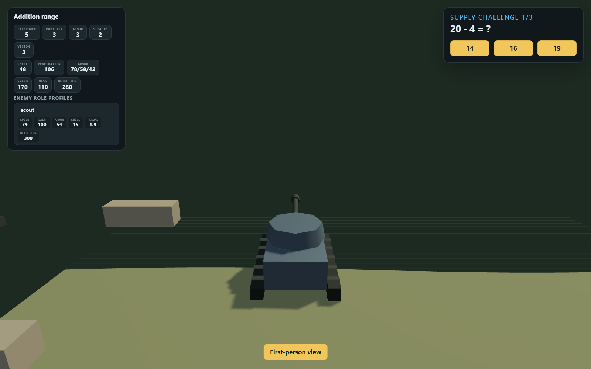
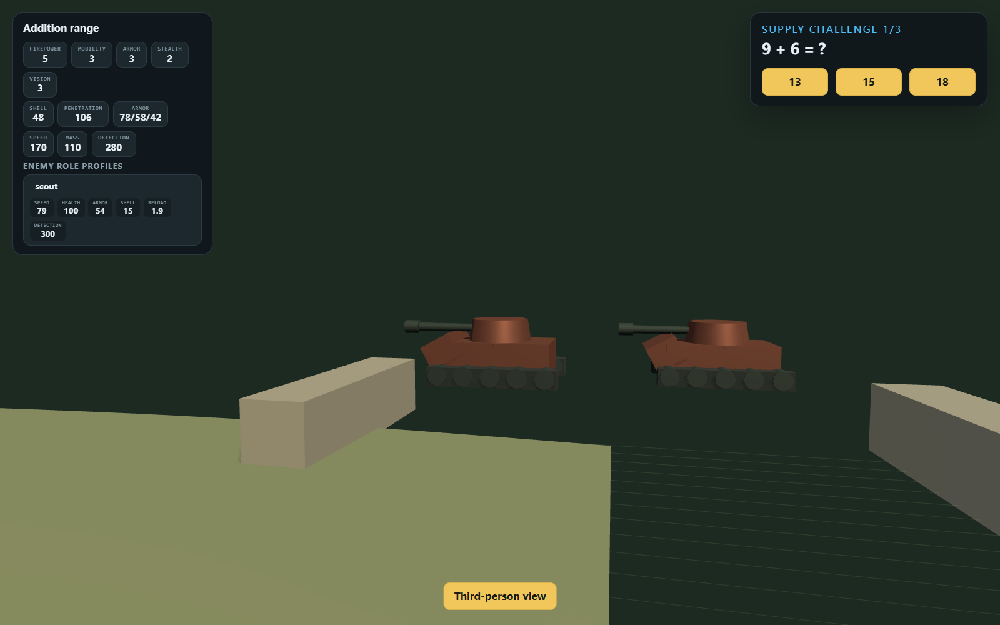
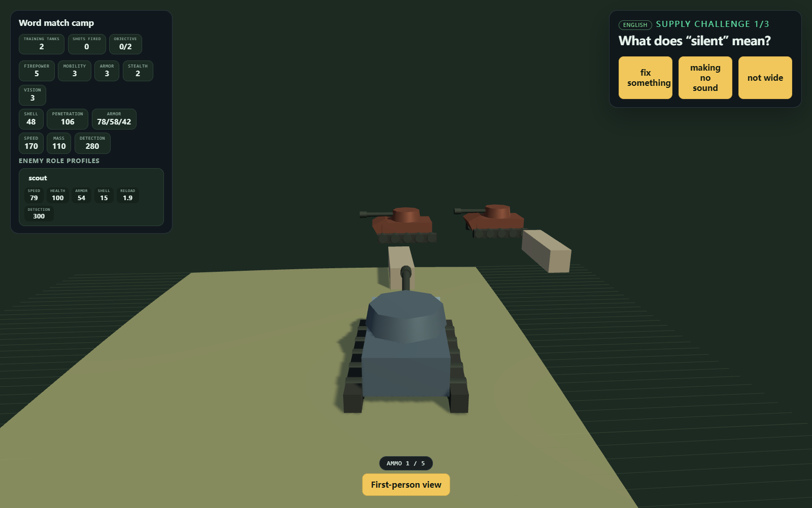
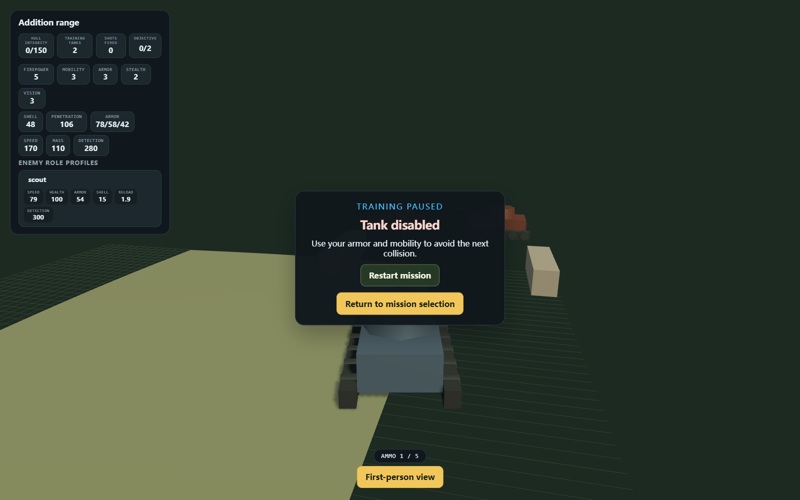

# 3D battle view

The battle screen uses Three.js by default. Add `?renderer=2d` to any URL to
use the Phaser scene instead, then pick a mission and start training.

## What it does

- Full-screen battlefield: ground with height variation, obstacles casting
  shadows, a PBR tank model on high quality, and procedural rigs on lower tiers.
- Information lives on the sides: mission and live counters on the left,
  the graded question on the right.
- Camera toggle (the button under the view): chase camera behind the hull,
  or a first-person camera on the turret roof following the view.
- Aiming follows the pointer in third person and the view direction in first
  person. The turret and gun aim at the nearest live tank or ground point hit by
  the reticle ray, using maximum shell range only when nothing is hit. Holding
  the right mouse button locks the turret so the camera can look around;
  releasing eases the view back behind the hull.
- Turret traverse speed comes from mobility (`turretTraverseSpeed`), so scouts
  swing faster than heavies.
- Every shot scatters: the shell lands anywhere inside a circle whose radius is
  the tank's `dispersionRadius` (bigger guns scatter more), sampled evenly.
- Driving uses the same input controller as the Phaser scene (`WASD`, arrows, on
  screen touch controls).
- Firing spends a round from a five-round magazine. A correct answer loads the
  ammo the backend granted; a wrong answer adds a reload penalty instead of
  taking a round away, so the child is never blocked.
- Enemies reload on their own timer, fire inside range and drain hull integrity.
  At zero the existing defeat card takes over with restart and return.
- Hull health, directional armour, penetration, damage, projectile speed,
  reload time, and mobility come from the selected tank and enemy presets.
- The seeded `target-range` mission places six passive targets at different
  distances and elevations for reproducible aiming and damage checks.

## Screens

| Third person                      | First person                      |
| --------------------------------- | --------------------------------- |
|  |  |

| English challenge                         | Defeat                |
| ----------------------------------------- | --------------------- |
|  |  |

## Code map

| File                                            | Role                                                               |
| ----------------------------------------------- | ------------------------------------------------------------------ |
| `apps/web/src/game/three/battle-scene-model.ts` | Field-to-world mapping, placements, camera poses, clamped movement |
| `apps/web/src/game/three/battle-combat.ts`      | Magazine, shell flight, hit resolution, enemy fire, hull damage    |
| `apps/web/src/game/three/battle-input.ts`       | Input snapshot and keyboard mapping                                |
| `apps/web/src/game/three/battle-view.ts`        | Three.js scene, meshes, render loop                                |
| `apps/web/src/game/three/Battle3DCanvas.tsx`    | React host, camera toggle, ammo badge                              |

The pure modules carry the tests; the renderer is exercised through screenshots
from the preview deployment.

## Known limits

- The first-person camera follows tank steering, not free mouse look.
- The 3D renderer ships beside Phaser, so the web performance budget covers both
  until Phaser is retired.
