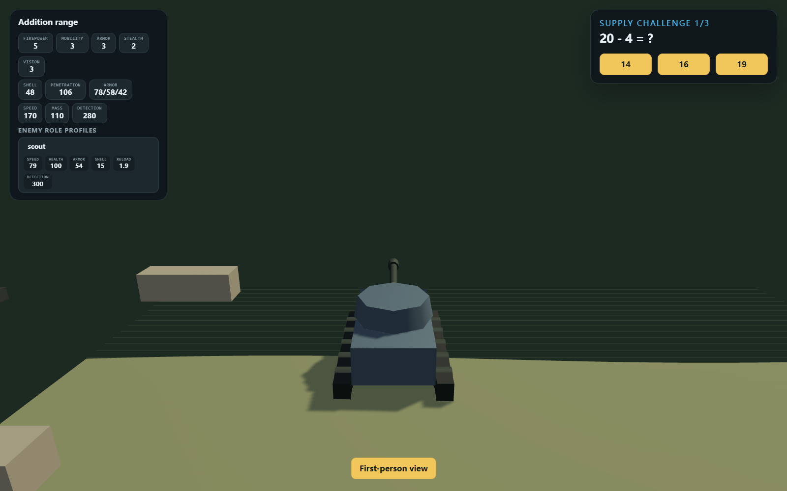
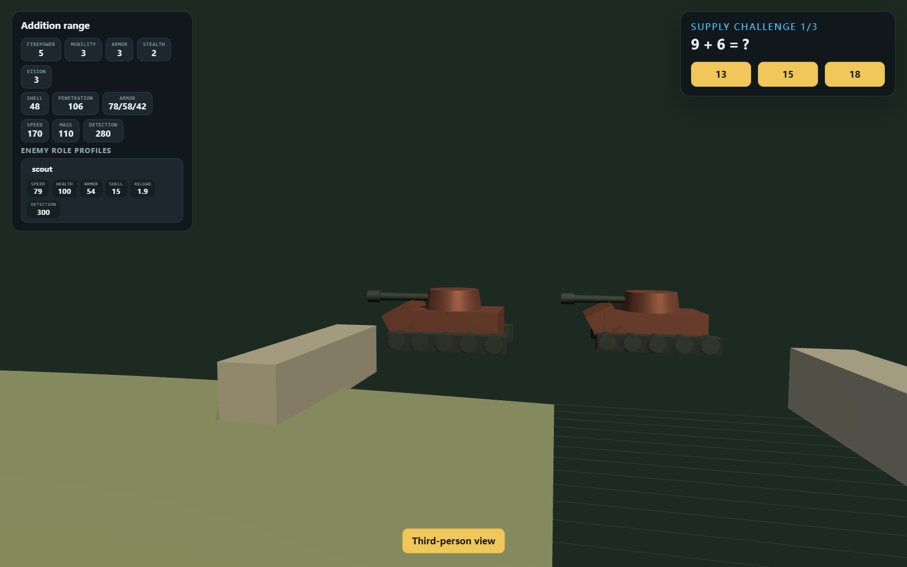
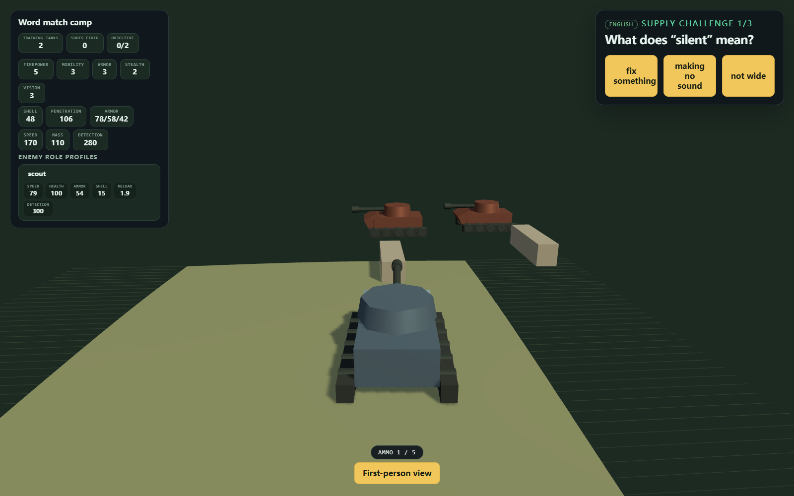
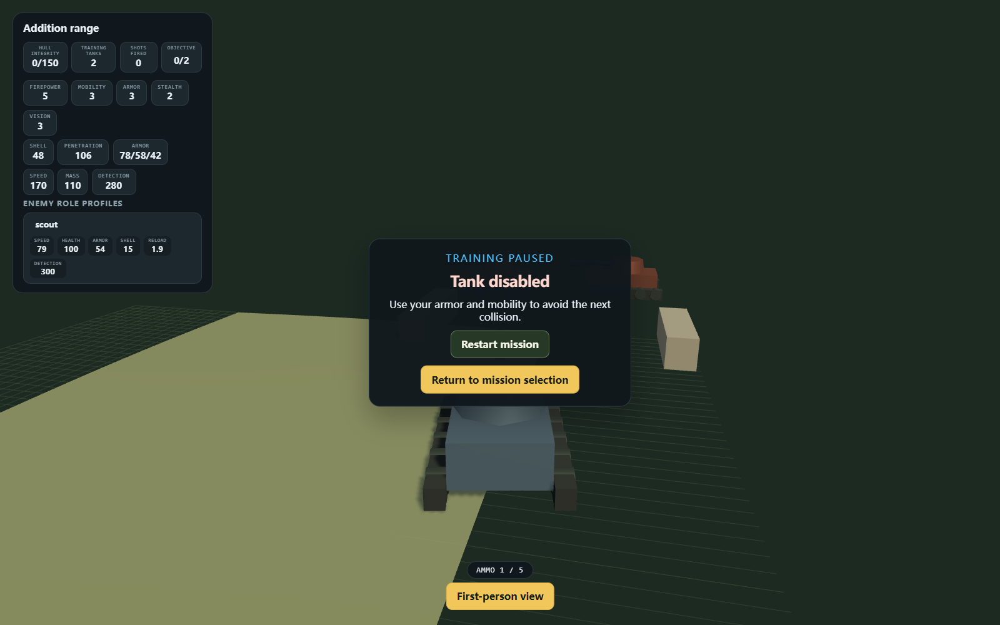

# 3D battle view

The battle screen has a second renderer built on Three.js. It stays opt-in while
the Phaser scene remains the default:

```
https://<host>/?renderer=3d
```

Add `?renderer=3d` to any URL, pick a mission and start training. The Phaser
scene is untouched, so removing the query string returns to the 2D view.

## What it does

- Full-screen battlefield: ground with height variation, obstacles casting
  shadows, low-poly tanks built from the runtime level config.
- Information lives on the sides: mission and live counters on the left,
  the graded question on the right.
- Camera toggle (`V` or the button under the view): chase camera behind the hull,
  or a first-person camera on the turret roof following the turret aim.
- Driving uses the same input controller as the Phaser scene (`WASD`, arrows, on
  screen touch controls).
- Firing spends a round from a five-round magazine. A correct answer loads the
  ammo the backend granted; a wrong answer adds a reload penalty instead of
  taking a round away, so the child is never blocked.
- Enemies reload on their own timer, fire inside range and drain hull integrity.
  At zero the existing defeat card takes over with restart and return.

## Screens

| Third person | First person |
| --- | --- |
|  |  |

| English challenge | Defeat |
| --- | --- |
|  |  |

## Code map

| File | Role |
| --- | --- |
| `apps/web/src/game/three/battle-scene-model.ts` | Field-to-world mapping, placements, camera poses, clamped movement |
| `apps/web/src/game/three/battle-combat.ts` | Magazine, shell flight, hit resolution, enemy fire, hull damage |
| `apps/web/src/game/three/battle-input.ts` | Input snapshot and keyboard mapping |
| `apps/web/src/game/three/battle-view.ts` | Three.js scene, meshes, render loop |
| `apps/web/src/game/three/Battle3DCanvas.tsx` | React host, camera toggle, ammo badge |

The pure modules carry the tests; the renderer is exercised through screenshots
from the preview deployment.

## Known limits

- The first-person camera follows tank steering, not free mouse look.
- Enemy tanks hold their spawn position; they do not chase.
- The 3D renderer ships beside Phaser, so the web performance budget covers both
  until Phaser is retired.
